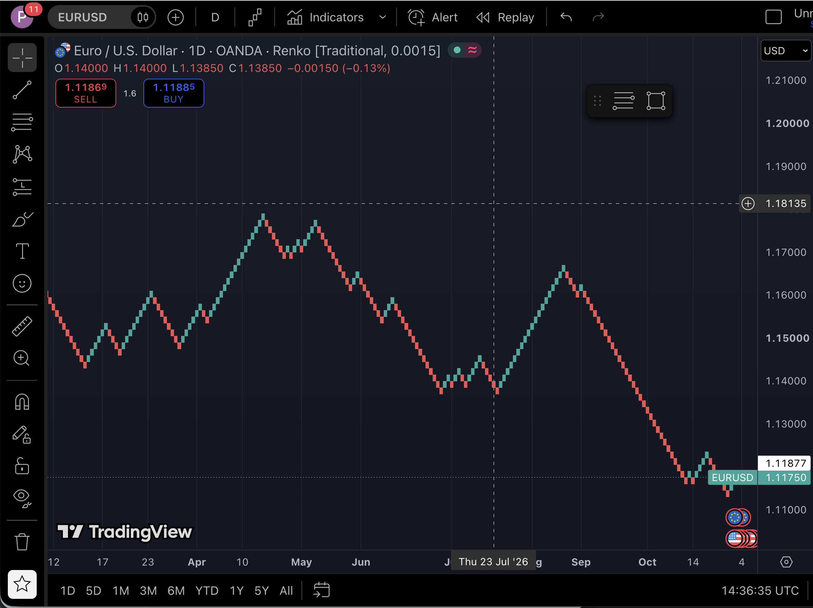
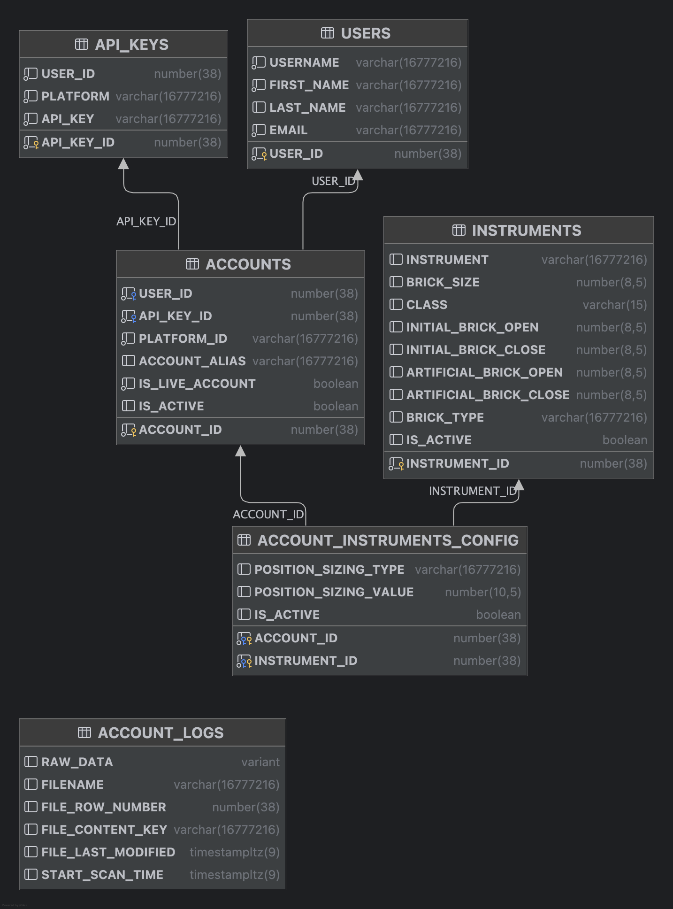
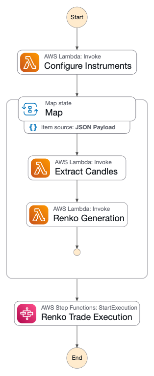

# Trading Bot: Aggregated Marginal Gains

This project is a personal exploration into scaling algorithmic trading by focusing on small, consistent gains across multiple instruments. Instead of hunting for high-alpha strategies on a single pair, this approach aims for modest, reliable returns (1-3% annually) spread across a wide portfolio.

## Project Thesis

Automation is the key to scaling small wins. For a \$1,000 account, a 1–3% annual return is only \$10–\$30 (roughly 100–300 pips). While this is a very achievable target for a human trader, doing it manually across dozens of currency pairs is exhausting and impractical. 

By automating this process, we can target these small returns across all major pairs simultaneously. This scales the aggregate return (e.g., 7-21%) without needing to increase the complexity or risk of the underlying strategy.

## Trading Strategy

The core challenge is still finding a winning logic, but by lowering the bar for target returns, we open up more possibilities. Simple strategies that might not be "profitable enough" for high-yield targets can become very effective in high-probability, low-yield scenarios.

## Risk Management

To keep things simple and safe, I use a standardized risk model: every position is limited to a fixed 1% risk of total account equity.

## The Renko Strategy

*Note: This strategy ultimately proved unsuccessful. The following serves as a retrospective on the implementation and lessons learned.*

Renko charts smooth price action into uniform bricks, filtering out market noise to highlight clear entry and exit points.

### Methodology

The initial logic was simple: go long when bricks shift from red to green, and go short when they shift from green to red. To evaluate this approach, I measured success by the net count of "bricks won."

To automate this research, I developed the [renko_generator.py](trading-bot/src/domain/renko_generator.py) module. This component generates a Renko graph programmatically, mirroring the output found on platforms like TradingView. A key technical requirement was the creation of "artificial starting bricks" to ensure proper chart alignment.

Preliminary research on the EUR/USD pair (conducted in [Hex](https://www.hex.tech)) suggested the idea was viable. However, scaling this research across multiple pairs required a more robust automated pipeline, leading to the development of the first State Machine.

### Automated Pipeline

To automate data extraction from Oanda and generate Renko data at scale, I utilized AWS Step Functions. While Dagster would have been the preferred orchestration tool, AWS Step Functions provided a cost-effective alternative for the cloud-native requirements of the project at the time.

The architecture was designed with future scalability in mind, including the potential to offer the bot as a service. One strategic consideration was how market saturation (multiple users trading at the same price points) might impact the strategy's edge.

The core architecture is illustrated below:

The `instruments` table serves as the global configuration store, maintaining the required brick sizes and artificial starting data for each pair. The state machine triggers hourly to pull the latest candle data and regenerate the Renko bricks—a resource-intensive process due to the complexities of real-time alignment.

### Data Processing with dbt

The Renko generation process integrates the [dbt_project](dbt_project) to handle data quality. Because the extraction process intentionally pulls overlapping candles (the current and previous) to account for Oanda API variability, dbt is used to deduplicate the `oanda_hour1_forex_candles` table into `oanda__hour1_forex_candles`.

The Renko generator processes this cleaned data and outputs to the `hour1_renko_bricks` table. This is then transformed by dbt into the final `oanda__hour1_renko_bricks` table, which includes several key analytical columns:
- `did_direction_shift`: Identifies trend reversals (buy-to-sell or vice-versa).
- `trend_group`: Groups sequential bricks of the same direction for trend analysis.